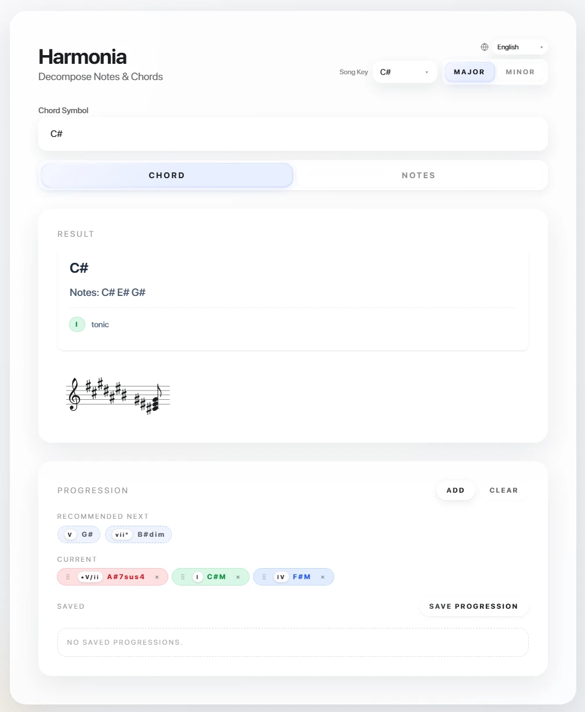

<h1 align="center">Harmonia 🎵</h1>
<h3 align="center">A Minimalist Music Theory & Chord Progression Tool</h3>

<div align="center">

Forked from: [不囉唆的和弦代號查詢器 by NiceChord 好和弦](https://github.com/wiwikuan/chordfinder)  
Modified by: arWai-CW

[](https://skillicons.dev)

English | [中文](https://github.com/arWai-CW/harmonia/blob/main/docs/README_zh.md)



</div>

---

## ℹ️ tl;dr

**Harmonia** is a music theory tool for looking up chord structures and building progressions.

- 🎹 Input a chord symbol → see its notes, sheet music, and harmonic analysis
- 🔍 Input notes → detect possible chords
- 🎼 Build chord progressions with drag-and-drop
- 🖥️ Works as a web app and native desktop app (Tauri)

Try it yourself: https://harmonia.arwai.org/

## 🆕 What I added

Changes from the original fork:

- Rebuilt the entire UI from scratch
- Added chord progression builder with drag-and-drop reordering
- Added chord analysis with Roman numeral notation
- Added notes-to-chord detection
- Packaged as a native desktop app using Tauri

## ✨ Features and Usage

**Harmonia** is a web and desktop music theory tool designed to help music enthusiasts quickly look up and understand chord structures.

### 🌟 Core Features

- **Chord Parsing**: Simply input a chord symbol (e.g., Cmaj7, F#m7b5, Bb13) to instantly view its constituent notes.
- **Notes Detection**: Input multiple notes (e.g., C E G) to detect possible chords.
- **Sheet Music Render**: Displays chords on a musical staff using ABC notation.
- **Harmonic Analysis**: Select a key (e.g., C Major or A Minor) to automatically view the correct note spellings and functional analysis.
- **Chord Progression Builder**: Create and save chord progressions with drag-and-drop reordering support.

### 💡 How to Use

1. Enter a chord name or notes in the input field.
2. Select the song's key (Major or Minor).
3. Instantly view the chord's notes, sheet music representation, and harmonic function.
4. Click the "Add" button to build a chord progression.
5. Use the drag-and-drop feature to rearrange the chord sequence to your liking.

### 🚀 Quick Start

- **Web Mode**: Run `bun run dev` to start the development server at `localhost:5173`.
- **Desktop Application**: Run `bun run t:dev` to launch the Tauri desktop app.

---

## 🏗️ Architecture

### 🛠️ Tech Stack

- **Frontend**: Vanilla JavaScript + Tailwind CSS v4
- **Desktop Framework**: Tauri (Rust + Web Technologies)
- **Music Theory Engine**: Tonal.js for chord analysis
- **Sheet Music Render**: abcjs for ABC notation display
- **UI Interaction**: SortableJS for drag-and-drop functionality

### 📁 Code Structure

```text
harmonia/
├── src/                    # Frontend source code
│   ├── main.js             # Application entry point (thin initializer)
│   ├── state.js            # State management & localStorage persistence
│   ├── renderer.js         # DOM rendering & ABC notation display
│   ├── events.js           # Event binding & input handling
│   ├── window-manager.js   # Floating window drag/resize
│   ├── chord-utils.js      # Music theory utility functions
│   ├── chord-function.js   # Harmonic function analysis (Roman numerals)
│   ├── styles.css          # Tailwind CSS styles
│   └── tests/              # Browser-based test framework
├── src-tauri/              # Tauri backend source code
└── docs/                   # Documentation
```

### 🧠 Core Concepts

1. **Factory Pattern**: Uses `createStorage()` and `createState()` to abstract state management.
2. **Pure Functions**: All music theory logic is built using pure functions without side effects.
3. **Event-Driven**: Relies on event listeners to handle user interactions.
4. **Local Storage**: Uses `localStorage` to persist progression and settings.
5. **Modular Design**: Clear separation of concerns across modules.

## 🧭 Design Philosophy

- **Simple & Intuitive**: No unnecessary clutter; strictly focused on core chord lookup functionality.
- **Performance First**: Built with pure JavaScript, avoiding heavy framework overhead.
- **Educational Tool**: Perfectly tailored for music students and composers wanting to understand chord structures.
- **Cross-Platform**: Runs seamlessly as both a web application and a desktop app.

### 🎨 Color Coding System

- 🟢 **Green**: Tonic function (I, iii, vi)
- 🔵 **Blue**: Subdominant function (ii, IV)
- 🔴 **Red**: Dominant function (V, vii°)

---

### 💻 Development Workflow

1. **Install Dependencies**: `bun install`
2. **Web Dev Server**: `bun run dev`
3. **Tauri Dev Server**: `bun run t:dev`
4. **Production Build**: `bun run build` (Web) or `bun run t:build` (Desktop)
5. **Run Tests**: Start dev server, then open `http://localhost:5173/tests/index.html`

### ⚙️ Recommended IDE Setup

- [VS Code](https://code.visualstudio.com/) + [Tauri Extension](https://marketplace.visualstudio.com/items?itemName=tauri-apps.tauri-vscode)
- [rust-analyzer](https://marketplace.visualstudio.com/items?itemName=rust-lang.rust-analyzer)
