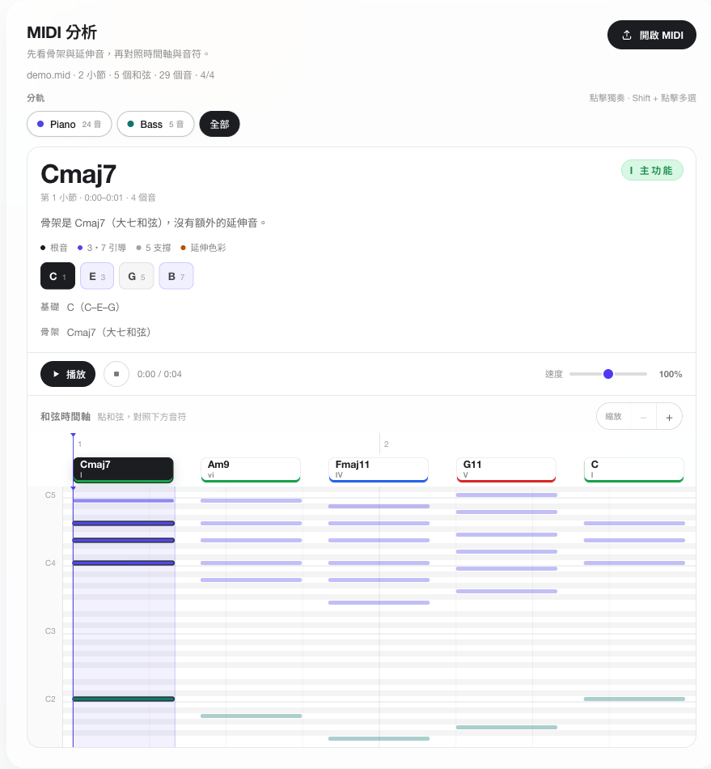

<h1 align="center">Harmonia</h1>

<p align="center">
  <strong>把和弦拆開，讓和聲看得見。</strong><br />
  給學習者與作曲者的和弦分析、MIDI 拆解與和聲練習工具。
</p>

<p align="center">
  <a href="https://tauri.app/"></a>
  <a href="https://vitejs.dev/"></a>
  <a href="https://tailwindcss.com/"></a>
  <a href="LICENSE"></a>
</p>



## 這是什麼

Harmonia 是一個網頁與桌面皆可使用的音樂理論工具。它不只告訴你「這個和弦有哪些音」，而是把和弦拆成可以理解的層次：

- 輸入 `Cm7add9`，馬上看到組成音、調性內的拼寫與和聲功能。
- 載入 MIDI，沿著時間軸看每個和聲的骨架、延伸音與基礎三和弦。
- 把和弦組成進行，累積自己的練習材料。

介面以鋼琴捲簾與時間軸為核心，讓「聲音」和「理論」出現在同一個畫面上。

## 功能

### 和弦拆解

輸入和弦代號，取得組成音、和弦性質與調性內的正確拼寫。`C#` 與 `Db` 不再混用；`F#m7b5`、`Bb13`、`Cmaj9` 這類代號都能直接解析。

### 調性與功能

選擇大調或小調，Harmonia 會標出每個和弦的羅馬數字與功能：

- 綠色：主功能（I、iii、vi）
- 藍色：下屬功能（ii、IV）
- 紅色：屬功能（V、vii°）

屬和弦、副屬和弦、借用和弦也會標示來源，而不是硬套一個看起來合理的級數。

### MIDI 分析

把 MIDI 檔拖進來，Harmonia 會沿著時間軸標出每個和弦：

- **骨架與延伸音**：`C11` 會拆成 `C7` 骨架加上 9、11，說明這個和弦是怎麼被疊出來的。
- **基礎三和弦**：`Cm7add9` 會標出 `Cm`（C–E–G），鋼琴捲簾同步外框根音、三度、五度，其餘音變淡。
- **分軌**：依音軌上色，點擊單獨聆聽，Shift 點擊可多選。
- **分解和弦**：沒有同時擊發、無法可靠判定的段落，標記為「分解／未判定」，不硬猜。
- **試聽與播放**：播放、暫停、停止、playhead、50%–150% 速度控制。

### 和弦進行

把查詢結果加入進行，拖放調整順序，儲存常用的進行。歷史記錄與進行都存在本機，不需要帳號。

## 快速開始

### 網頁版

需要 [Bun](https://bun.sh/)。

```bash
bun install
bun run dev
```

打開 `http://localhost:5173`。

### 桌面版

需要 Rust 與 Tauri 的系統依賴。

```bash
bun run t:dev
```

打包桌面安裝檔：

```bash
bun run t:build
```

## Development

**Stack**：Vanilla JavaScript、Vite、Tailwind CSS v4、Tauri 2。音樂理論使用 Tonal，樂譜使用 abcjs，MIDI 解析使用 `@tonejs/midi`。

```text
src/
├── main.js           # 應用入口、狀態與畫面渲染
├── chord-utils.js    # 和弦解析、調性與音名拼寫
├── chord-function.js # 羅馬數字與和聲功能分析
├── midi-utils.js     # MIDI 解析、和弦切段、骨架與基礎三和弦
├── drag-utils.js     # 拖放封裝
├── index.html
└── styles.css
```

常用指令：

| 指令              | 用途                     |
| ----------------- | ------------------------ |
| `bun run dev`     | 啟動網頁開發伺服器       |
| `bun run build`   | 建置網頁版到 `dist/`     |
| `bun run t:dev`   | 啟動 Tauri 桌面開發模式  |
| `bun run t:build` | 建置桌面安裝檔           |

測試是瀏覽器內的輕量測試框架，沒有額外 test runner：

```bash
bunx vite . --port 5174
```

打開 `http://localhost:5174/tests/index.html`。音樂理論邏輯請優先補上 `tests/` 下的測試。

## Credits

Fork 自 [不囉唆的和弦代號查詢器](https://github.com/wiwikuan/chordfinder) by NiceChord 好和弦，由 arWai 修改與延伸。

感謝 Tonal、abcjs、Tone.js MIDI、Tauri、Tailwind CSS 與 Vite。

授權：[GPL-3.0](LICENSE)。
