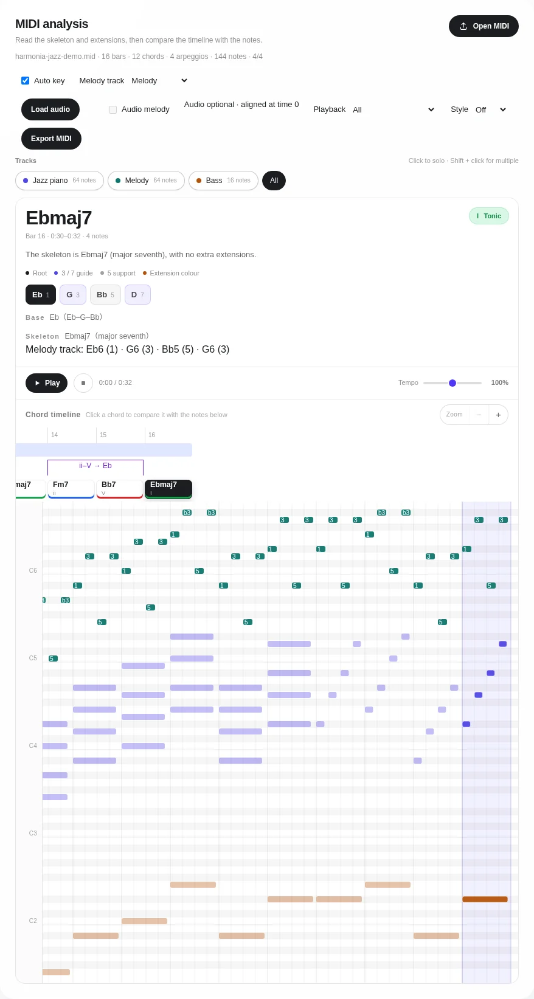
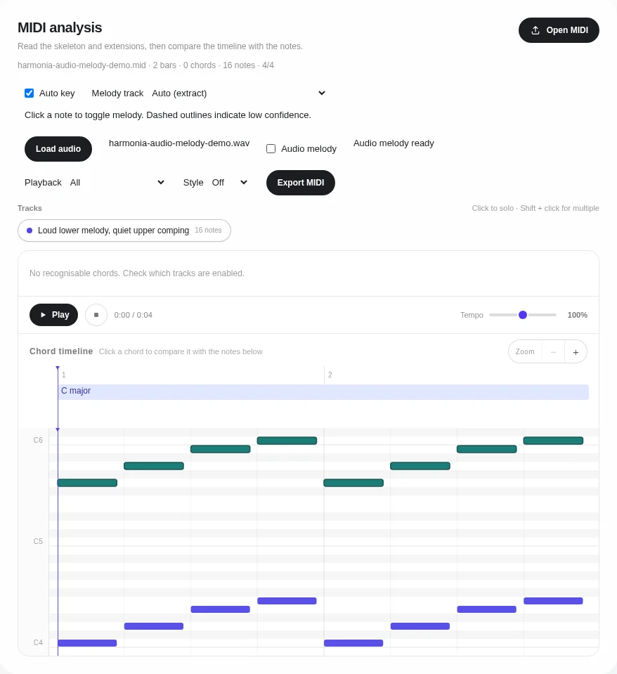
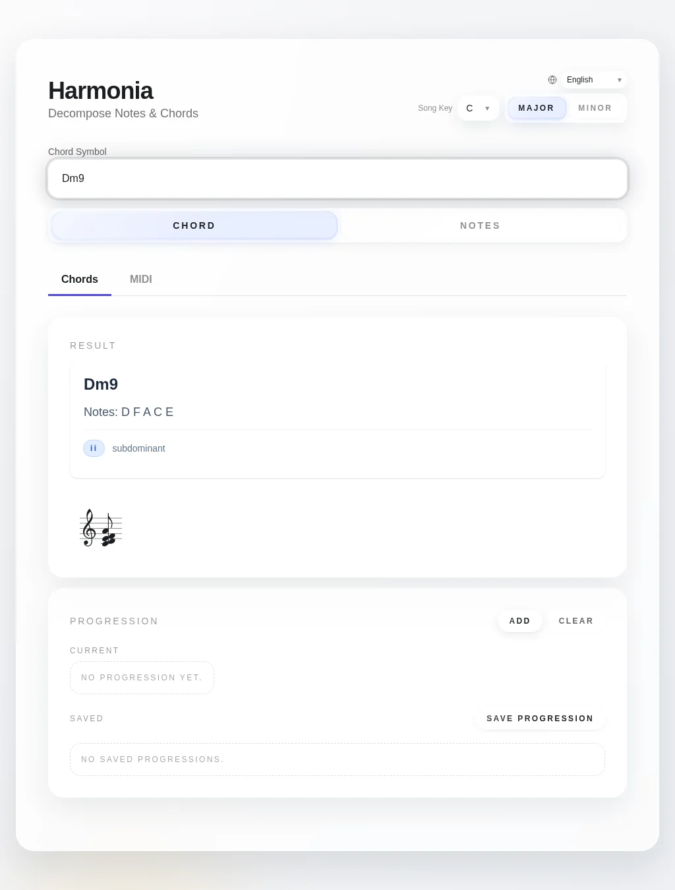

# Harmonia

**Understand a jazz transcription, follow its melody, and audition a different arrangement before writing the parts.**


[Web app](https://harmonia.arwai.org/) · English / [繁體中文](docs/README_zh.md) · [Quick start](#quick-start)

Harmonia is a browser and Tauri desktop workspace for chord lookup, progressions and MIDI analysis. This fork is based on [不囉唆的和弦代號查詢器 by NiceChord 好和弦](https://github.com/wiwikuan/chordfinder), with the interface and additional analysis tools developed by **arWai-CW**. Features described here reflect this branch; the hosted app may run a different revision.

## What it is for

### Transcribing jazz that changes key

A fixed song key stops being useful when a tune modulates or moves through secondary cadences. Load the MIDI to see estimated local keys, chord functions and resolution brackets on the same timeline, then inspect the notes behind each chord reading.

### Finding the tune in a mixed piano transcription

A MuScriptor transcription can put chords and melody on one piano track, with the tune changing hands. Auto extraction follows a single line across tracks and registers; source audio supplies a second opinion, and individual notes remain editable when the estimate is wrong.

### Trying a jazz tune as rock or pop

Before arranging every part, hear what the harmony does with simpler chords and a different rhythm. Style preview replaces the accompaniment, keeps the chosen melody, and exports separate tracks to continue working in a DAW or notation editor.

## Read the harmony in context


- **Local keys and modulation:** duration-weighted pitch-class profiles and a Viterbi pass estimate stable key regions. With **Auto key** on, Roman numerals and function colours use the region at the chord's time. Turn it off to compare everything against the song key.
- **Cadence brackets:** ii–V, tritone substitutions and backdoor approaches show their target key. Dashed brackets mark unresolved targets; related patterns share a chain colour.
- **Melody roles:** choose a melody track or Auto extraction to label chord tones, tensions and stepwise passing/neighbor tones in the piano roll. Selecting a chord lists the melody notes over it.
- **Track isolation and playback:** enable tracks independently, solo a part, change playback speed, or use **All / Melody only / Accompaniment only** to listen to the current division.

These are harmonic readings, not a transcription verdict. An ambiguous backdoor passage can receive a different estimated local key from its bracket's destination. The Auto key switch lets you compare interpretations without changing the source MIDI.

## Name broken chords, not just simultaneous attacks



Held arpeggios and staccato broken chords contribute to beat-grid pitch histograms. Template scoring and a chord-sequence search produce named segments rather than an unlabelled arpeggio span. Mostly stepwise single-line passages are guarded against being mistaken for broken chords.

The detail panel separates the basic triad, guide tones and extensions. The selected melody is excluded from harmony detection, so a passing tune note does not automatically become a chord extension.

## Follow a melody across both hands


Choose **Auto (extract)** in the Melody selector for mixed piano MIDI. Notes from the enabled tracks are merged into onset clusters, without relying on track or hand identity. A Viterbi-style path balances pitch height, duration, chord position and continuity, so it can follow the line into the left hand while the right hand comps above it.

- Extracted notes are highlighted; dashed outlines indicate low confidence.
- Click a note, or focus it and press Enter/Space, to toggle melody membership. Harmony and melody labels recompute immediately.
- Corrections stay in memory for the loaded file; they are not saved into the source MIDI.
- MuScriptor writes constant velocity 100. Constant or nearly constant velocity is automatically ignored rather than treated as a loudness measurement.

This is a heuristic for finding a plausible single line. It does not separate several independent melodies or guarantee that every hand swap is inferred correctly.

## Compare MIDI-only and audio-assisted extraction

| Audio melody off | Audio melody on |
| --- | --- |
|  |  |

Load the original **WAV or MP3** next to the MIDI, then use **Audio melody** to compare. It defaults on after audio analysis completes. In this synthesized example, MIDI-only extraction chooses G5–A5–B5–C6; audio-assisted extraction follows the louder C4–D4–E4–F4 line instead.

The audio path downmixes to mono and estimates a predominant pitch contour using spectral peaks, harmonic salience and voiced/unvoiced sequence tracking. Duration overlap matches that contour back to MIDI notes; harmonic onset loudness is a secondary cue. Anti-aliased resampling and analysis run in a worker, with an analysing state while the UI stays responsive. No audio-analysis dependency or server upload is used by this feature.

Audio and MIDI are assumed to start at time zero. The pure matching utilities accept an offset, but there is no alignment slider in the UI. Dense recordings, octave ambiguity and recordings with prominent non-melody parts still need listening and manual corrections. The screenshots and regression tests use synthetic audio, not a real-recording accuracy benchmark.

## Audition a style, then export the parts


Choose **Rock, Pop, Funk or Ballad** beside the playback-mode selector. Playback uses generated chords and bass plus the current melody. The smaller arrow line under each original chord shows the preview chord; **Off** restores original-note playback and the normal Roman-numeral display.

| Style | Harmonic treatment | Accompaniment |
| --- | --- | --- |
| Rock | ii in an annotated ii–V becomes IV; subV becomes V; passing diminished chords hold the previous chord; power chords throughout | Low root–fifth–octave voicings, eighth-note chugs and root bass eighths |
| Pop | Keep ii; simplify to triads, add9 or sus4; subV becomes V | Chords on beats 1 and 3 with an anticipation; root–fifth bass |
| Funk | Keep substituted roots; dominants become 9, minor chords m7/m9, major chords maj7 | Short offbeat sixteenth-grid stabs and syncopated octave bass |
| Ballad | Preserve extended/altered harmony; enrich plain major/minor chords with sevenths | Open sustained voicings and half-note bass |

Rules use harmonic function relative to the detected local key, or the song key when Auto key is off. Annotated secondary ii–V/subV patterns use their own target. There is no per-key replacement table. Candidate inversions and drops are selected across the chord sequence with dynamic programming to reduce semitone movement and register drift. Slash bass is retained. Patterns are clipped at chord boundaries and also work in 3/4.

**Export MIDI** downloads `<source>-<style>.mid` with **Chords**, **Bass** and **Melody** tracks. Export includes the complete preview, regardless of the listening filter. It uses the view's meter and fixed beat duration; it is an arranging sketch, not a full rhythm section, a realistic instrument render, or a reconstruction of a changing tempo map. The piano roll and analysis remain the original notes; the smaller chord symbols describe the generated accompaniment. The optional rock bVII cadence rewrite is deliberately not applied.

## Work out a chord before working on the whole tune



Enter a chord such as `Dm9`, `F#m7b5` or `Bb13` to inspect its spelling and staff notation. Switch to notes input to find candidate chords from pitch names. Set a major/minor key for harmonic function, then add chords to a progression, reorder them by dragging, and save the result locally.

## Quick start

Install [Bun](https://bun.sh/), then:

```sh
git clone https://github.com/arWai-CW/harmonia.git
cd harmonia
bun install
bun run dev
```

Open `http://localhost:5173`. In the **MIDI** tab, load a `.mid` or `.midi` file, check the enabled tracks and choose a melody source before comparing styles. Original MIDI files are not overwritten.

| Command | Purpose |
| --- | --- |
| `bun run dev` | Vite development server |
| `bun run build` | Production web build in `dist/` |
| `bun run preview` | Serve the production build locally |
| `bun run t:dev` | Tauri desktop development |
| `bun run t:build` | Build the desktop application |

Tauri development also needs Rust and the [platform prerequisites](https://v2.tauri.app/start/prerequisites/). Desktop packaging is separate from the web build.

### Tests

With the dev server running, open `http://localhost:5173/tests/index.html`. The custom browser harness covers chord utilities, MIDI segmentation, key/cadence analysis, melody extraction, audio cues, style substitutions, voice leading, rhythms and MIDI export round trips. A production build does not run these tests.

## Technology and architecture

Vanilla JavaScript ES modules, Vite, Tailwind CSS v4 and Tauri/Rust form the application. Tonal provides music-theory primitives, abcjs renders notation, SortableJS handles progression ordering, and `@tonejs/midi` reads and writes MIDI. The interface is available in English, Traditional Chinese, Simplified Chinese and Japanese.

| Module | Responsibility |
| --- | --- |
| `main.js`, `events.js`, `renderer.js` | Initialization, event binding and chord-workspace rendering |
| `state.js`, `window-manager.js` | State/localStorage and floating windows |
| `chord-utils.js`, `chord-function.js` | Chord spelling and harmonic function |
| `midi-utils.js` | MIDI parsing, track filtering and chord segmentation |
| `harmony-analysis.js` | Local keys, cadence chains, note roles and arpeggio naming |
| `melody-extraction.js` | Mixed-track melody paths and manual overrides |
| `audio-melody.js`, `audio-melody-worker.js` | Pure spectral analysis, note matching and worker execution |
| `style-preview.js` | Pure substitutions, voicing DP, rhythms and MIDI construction |
| `midi-panel.js` | Timeline, piano roll, playback, file controls and downloads |
| `src/i18n/`, `src/tests/` | Four locales and the browser test harness |

Music-analysis utilities are kept separate from DOM rendering. Factory-based state/storage and event listeners coordinate the UI; settings and saved progressions use localStorage. Browser file APIs and Web Audio handle local MIDI/audio processing. Source screenshots live in `docs/`; demo MIDI and WAV inputs are not bundled.
