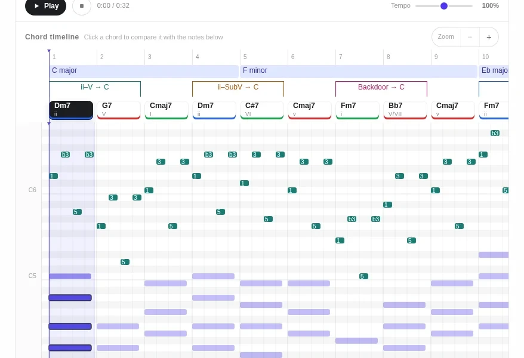
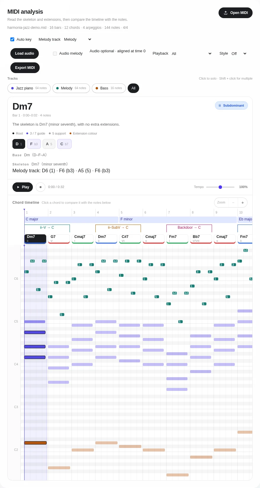
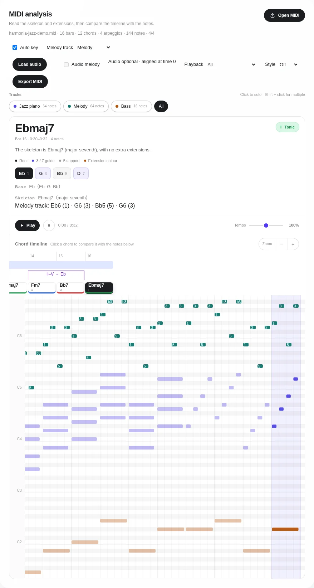
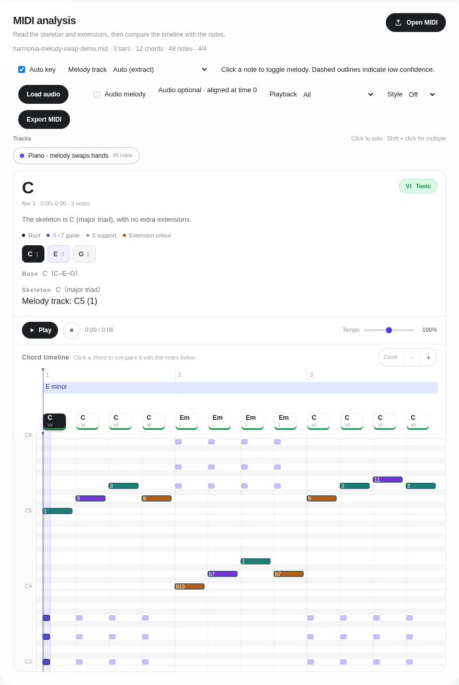
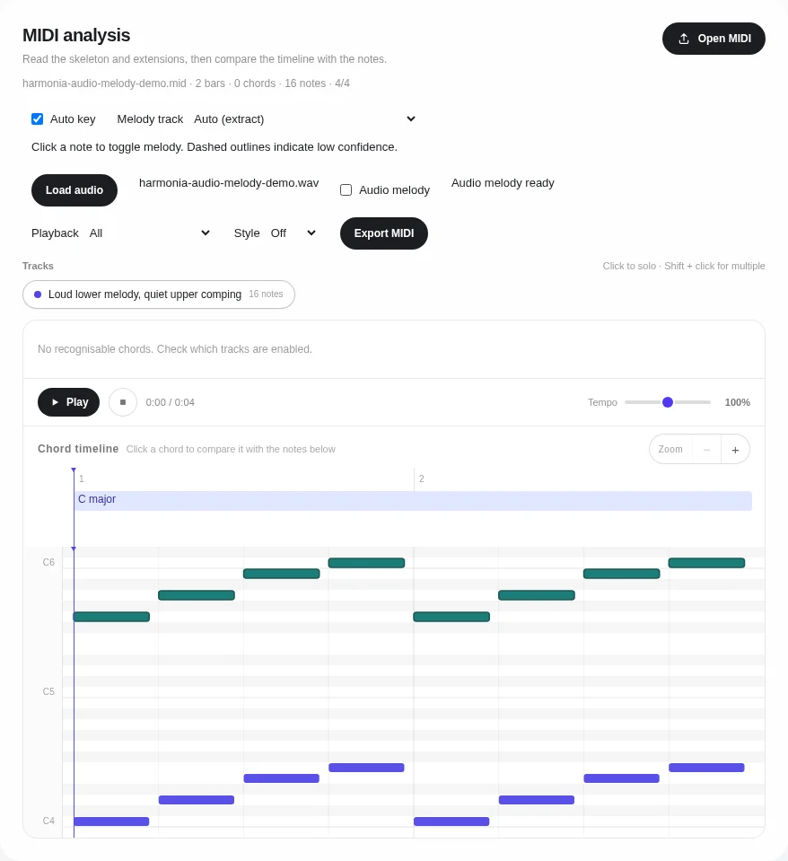
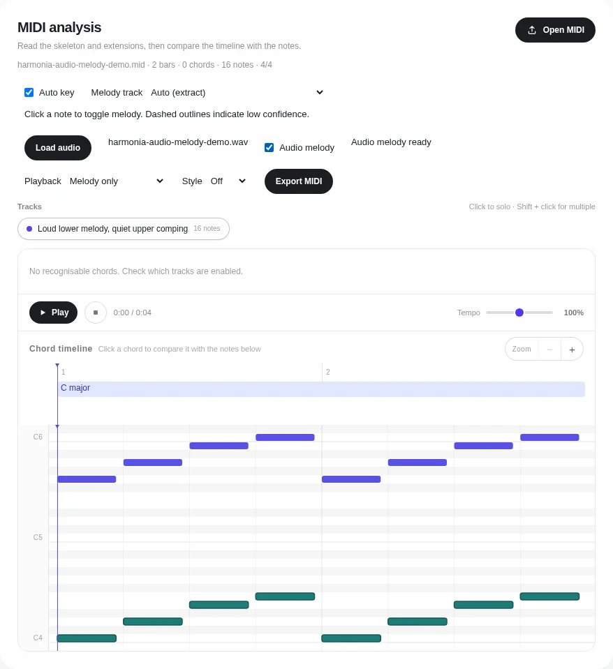
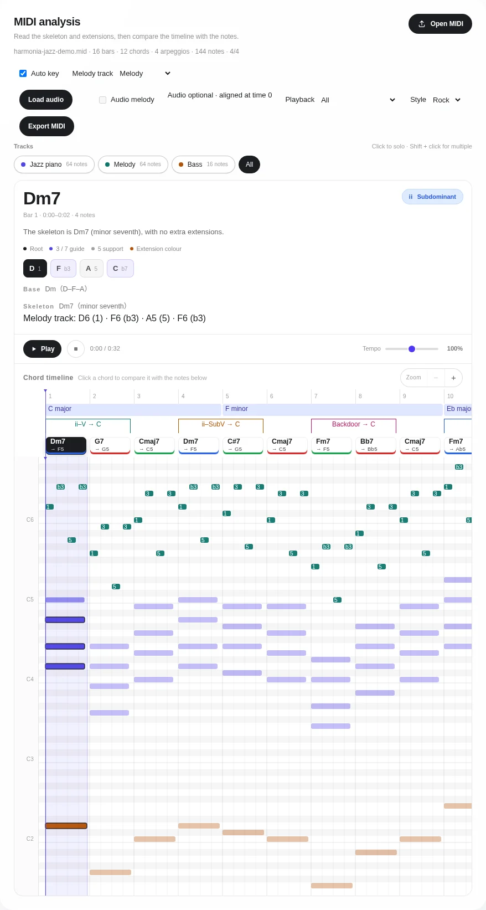
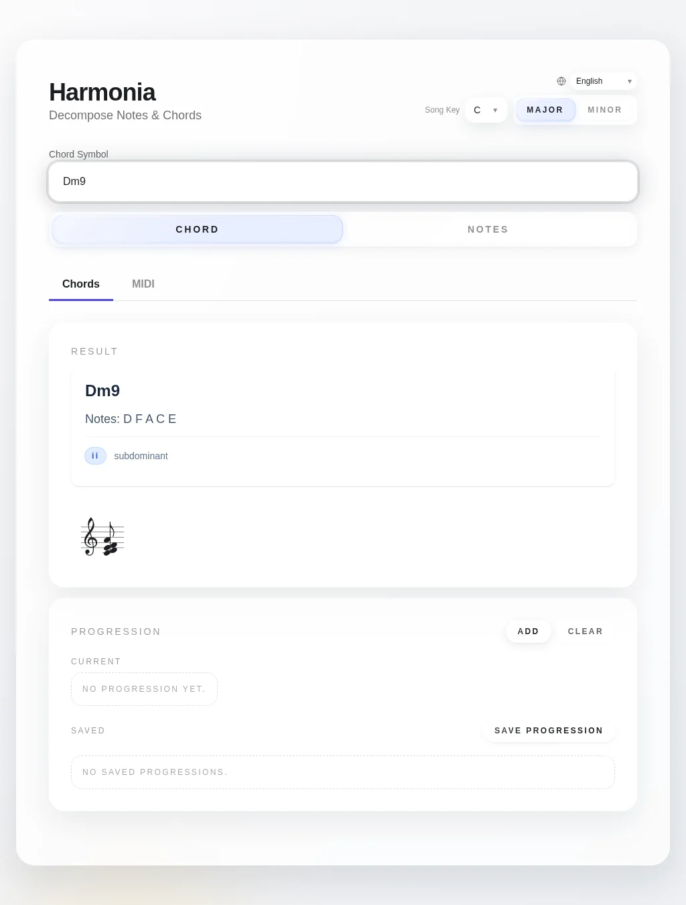

# Harmonia

**看懂爵士扒譜、追蹤主旋律，並在動手寫聲部之前，先試聽另一種編曲方向。**



[網頁版](https://harmonia.arwai.org/) · [English](../README.md) / 繁體中文 · [快速開始](#快速開始)

Harmonia 是用於查詢和弦、建立和弦進行與分析 MIDI 的網頁及 Tauri 桌面工具。本專案 fork 自 [NiceChord 好和弦的「不囉唆的和弦代號查詢器」](https://github.com/wiwikuan/chordfinder)，由 **arWai-CW** 改寫介面並加入分析功能。本頁描述的是此分支；線上網站可能仍使用其他版本。

## 可以用來做什麼

### 扒一首會轉調的爵士曲

當樂曲不斷轉調，或出現次屬和弦與連續終止式時，單一歌曲調性往往不足以解釋全部和聲。載入 MIDI 後，可以在同一條時間軸上對照估計的局部調性、和弦功能與解決目標，再查看支撐和弦判讀的實際音符。

### 從混合鋼琴扒譜中找出主旋律

MuScriptor 轉出的鋼琴 MIDI 可能把伴奏與旋律放在同一音軌，而主旋律又在左右手之間交接。自動擷取會跨音軌與音域追蹤單一旋律；原始音訊提供另一個判斷依據，判錯的音符仍可逐一修正。

### 編曲前先試聽爵士曲改成搖滾或流行

不必先寫完所有聲部，就能聽聽簡化和弦與節奏型之後的走向。風格試聽會替換伴奏、保留選定的旋律，並匯出獨立聲部，方便接著在 DAW 或打譜軟體中編修。

## 在上下文中閱讀和聲



- **局部調性與轉調：**以音符時值加權的音級分布及 Viterbi 路徑估計穩定的調性區段。開啟「自動調性」時，羅馬數字與功能顏色跟隨該和弦所在的區段；關閉後，全部改用歌曲調性。
- **終止式括號：**標出 ii–V、三全音代理與後門進行的目標調性。虛線表示尚未解決的目標，相關進行以同一組顏色串接。
- **旋律音角色：**選擇旋律音軌或自動擷取後，鋼琴捲軸會標出和弦音、張力音，以及級進經過音／鄰音。點選和弦也能查看其上的旋律音。
- **音軌與播放：**可獨立啟用音軌、獨奏、調整播放速度，或以「全部／僅旋律／僅伴奏」聆聽目前的聲部分類。

這些是和聲判讀建議，不是扒譜的標準答案。模糊的後門進行，其估計局部調性可能與括號所指向的目標不同。自動調性開關讓你比較兩種解釋，不會更改來源 MIDI。

## 分解和弦也能命名



延音琶音與斷奏分解和弦都會納入逐拍音級統計，再透過和弦模板評分與序列搜尋產生有名稱的區段，而不只是標記「分解和弦」。分析也會排除大部分以級進為主的單音樂句，減少把音階誤認成和弦的情況。

詳情面板會拆解基本三和弦、導引音與延伸音。選定的旋律不參與和聲辨識，因此旋律中的經過音不會直接被當成和弦延伸音。

## 跟隨在左右手之間移動的旋律



對混合鋼琴 MIDI，可在旋律選單選擇「自動（擷取）」。啟用音軌中的音符會合併成起音群組，不依賴音軌或左右手標記。Viterbi 類型的路徑搜尋綜合音高、時值、和弦中的位置與旋律連續性，讓旋律可以移到左手，即使右手在更高音域彈伴奏。

- 擷取出的音符會高亮顯示；虛線外框代表低信心判斷。
- 點選音符，或聚焦後按 Enter／空白鍵，可切換旋律身分，和聲與旋律標記會立即重算。
- 修正僅保留於目前載入檔案的記憶體中，不會寫回來源 MIDI。
- MuScriptor 將所有音符力度設為 100。固定或幾乎固定的力度會自動停用，不會被誤當成真實響度。

這是尋找合理單一旋律的啟發式方法，並非多旋律分離工具，也不保證每次左右手交接都判斷正確。

## 比較純 MIDI 與音訊輔助的結果

| 關閉音訊旋律 | 開啟音訊旋律 |
| --- | --- |
|  |  |

載入同一段扒譜的原始 **WAV 或 MP3**，再以「音訊旋律」開關比較。分析完成後會預設開啟。在這個合成示範中，純 MIDI 選到 G5–A5–B5–C6；音訊輔助則追蹤較響亮的 C4–D4–E4–F4。

音訊會混成單聲道，透過頻譜峰值、諧波顯著度與有聲／無聲序列追蹤，估計主要音高輪廓，再依時值重疊將輪廓對應回 MIDI 音符。起音附近的諧波響度是次要線索。具有抗混疊濾波的重取樣與分析在 Worker 中執行，期間顯示分析中狀態，介面仍可操作。此功能不依賴外部音訊分析套件，也不會將檔案上傳至伺服器。

目前假設 MIDI 與音訊都從時間 0 開始。純函式支援時間偏移參數，但介面尚無對齊滑桿。密集錄音、八度混淆，或伴奏特別突出的錄音，仍需要聆聽與手動修正。截圖與回歸測試使用合成音訊，不代表真實錄音的準確率評測。

## 試聽風格，再匯出聲部



在播放範圍旁選擇「搖滾、流行、放克、抒情」。播放會改用產生的和弦與貝斯，加上目前選定的旋律。原和弦下方的箭頭小字是試聽和弦；選擇「關閉」會恢復原音符播放與一般羅馬數字顯示。

| 風格 | 和聲處理 | 伴奏方式 |
| --- | --- | --- |
| 搖滾 | 已標記 ii–V 中的 ii 改為 IV；subV 改為 V；經過減和弦延續前一和弦；全部化為強力和弦 | 低音域根音、五度、八度配置；八分音符刷奏與根音貝斯 |
| 流行 | 保留 ii；簡化為三和弦、add9 或 sus4；subV 改為 V | 第一、三拍和弦加預拍；根音與五度貝斯 |
| 放克 | 保留代理和弦根音；屬和弦改為 9，小和弦用 m7／m9，大和弦用 maj7 | 十六分格線上的短促反拍和弦、切分八度貝斯 |
| 抒情 | 保留延伸與變化和聲；單純大小和弦加入七度 | 開放排列的持續和弦、二分音符貝斯 |

規則依估計局部調性中的功能運作；關閉自動調性時，則改用歌曲調性。已標記的次級 ii–V／subV 進行使用各自的目標，不需要為十二個調建立替換表。轉位與 drop voicing 候選會經過整段動態規劃，減少半音移動與音域漂移。斜線貝斯會保留，節奏型在和弦邊界截斷，也支援 3/4 拍。

「匯出 MIDI」會下載 `<來源>-<風格>.mid`，包含**和弦、貝斯、旋律**三條音軌。匯出的是完整試聽，不受目前聆聽範圍影響。它使用分析檢視的拍號與固定拍長，是編曲草稿，不是完整節奏組、真實樂器演奏，亦不會重建原檔的變速圖。鋼琴捲軸與分析仍顯示原音符，小字和弦才是產生的伴奏。可選的搖滾 bVII 終止替換刻意不套用。

## 先弄懂一個和弦，再處理整首歌



輸入 `Dm9`、`F#m7b5` 或 `Bb13`，可查看和弦拼寫與五線譜。切換至音符輸入，可依音名尋找候選和弦。設定大小調以閱讀和聲功能，再把和弦加入進行、拖曳排序並儲存在本機。

## 快速開始

安裝 [Bun](https://bun.sh/) 後執行：

```sh
git clone https://github.com/arWai-CW/harmonia.git
cd harmonia
bun install
bun run dev
```

開啟 `http://localhost:5173`。在 **MIDI** 分頁載入 `.mid` 或 `.midi`，先檢查啟用的音軌並選擇旋律來源，再比較不同風格。來源 MIDI 不會被覆寫。

| 指令 | 用途 |
| --- | --- |
| `bun run dev` | Vite 開發伺服器 |
| `bun run build` | 將網頁正式版本輸出至 `dist/` |
| `bun run preview` | 在本機預覽正式建置 |
| `bun run t:dev` | Tauri 桌面開發 |
| `bun run t:build` | 建置桌面應用程式 |

Tauri 開發另需 Rust 與[各平台先決條件](https://v2.tauri.app/start/prerequisites/)。桌面封裝與網頁建置是不同步驟。

### 測試

啟動開發伺服器後，開啟 `http://localhost:5173/tests/index.html`。自訂瀏覽器測試涵蓋和弦工具、MIDI 分段、調性／終止式分析、旋律擷取、音訊線索、風格替換、聲部進行、節奏型與 MIDI 匯出往返解析。正式建置不會自動執行測試。

## 技術與架構

應用程式使用原生 JavaScript ES modules、Vite、Tailwind CSS v4，以及 Tauri／Rust。Tonal 提供樂理工具，abcjs 繪製樂譜，SortableJS 處理和弦進行排序，`@tonejs/midi` 讀寫 MIDI。介面支援英文、繁體中文、簡體中文與日文。

| 模組 | 職責 |
| --- | --- |
| `main.js`、`events.js`、`renderer.js` | 初始化、事件綁定與和弦工作區繪製 |
| `state.js`、`window-manager.js` | 狀態、localStorage 與浮動視窗 |
| `chord-utils.js`、`chord-function.js` | 和弦拼寫與和聲功能 |
| `midi-utils.js` | MIDI 解析、音軌篩選與和弦分段 |
| `harmony-analysis.js` | 局部調性、終止式串接、音符角色與分解和弦命名 |
| `melody-extraction.js` | 混合音軌旋律路徑與手動修正 |
| `audio-melody.js`、`audio-melody-worker.js` | 純頻譜分析、音符對應與 Worker 執行 |
| `style-preview.js` | 純函式風格替換、聲部動態規劃、節奏與 MIDI 建構 |
| `midi-panel.js` | 時間軸、鋼琴捲軸、播放、檔案控制與下載 |
| `src/i18n/`、`src/tests/` | 四種語言與瀏覽器測試框架 |

音樂分析工具與 DOM 繪製分開，透過工廠模式狀態／儲存層及事件監聽器協調介面；設定與已儲存進行使用 localStorage。瀏覽器檔案 API 與 Web Audio 在本機處理 MIDI／音訊。實際畫面截圖放在 `docs/`，示範 MIDI 與 WAV 不隨專案提交。
